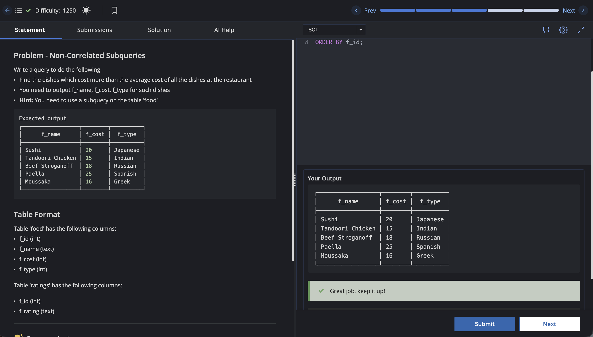

# Experiment 10.2

Name: Pahulpreet Singh

UID: 24BCS10261

## Aim

To find dishes whose cost is greater than the average cost of all dishes using a non-correlated subquery.

## Question

Write a query to display `f_name`, `f_cost`, and `f_type` for dishes whose cost is greater than the average cost of all dishes at the restaurant.

## SQL Queries Used

```sql
SELECT f_name, f_cost, f_type
FROM food
WHERE f_cost > (
    SELECT AVG(f_cost)
    FROM food
)
ORDER BY f_id;
```

## Output

```text
     f_name      | f_cost |  f_type
-----------------+--------+----------
 Sushi           |     20 | Japanese
 Tandoori Chicken|     15 | Indian
 Beef Stroganoff |     18 | Russian
 Paella          |     25 | Spanish
 Moussaka        |     16 | Greek
(5 rows)
```

## Output Screenshot



## Image Explanation

The query uses a non-correlated subquery to calculate the average cost of all dishes. It then returns only dishes whose cost is greater than that average. The result contains Sushi, Tandoori Chicken, Beef Stroganoff, Paella, and Moussaka.

## Result

The non-correlated subquery successfully displayed the five dishes whose cost was greater than the average dish cost.

