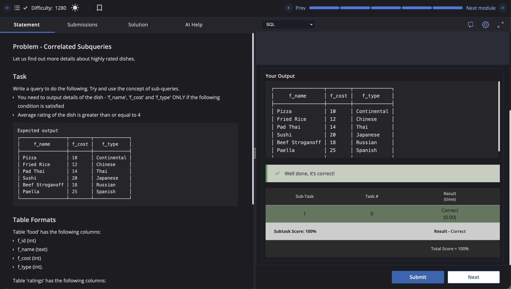

# Experiment 10 - Task 3

Name: ABHINEET

UID: 24BCS10039

## Aim

To find highly rated dishes using a correlated subquery.

## Question

Write a query to display `f_name`, `f_cost`, and `f_type` for dishes whose average rating is greater than or equal to 4.

## SQL Queries Used

```sql
SELECT f.f_name, f.f_cost, f.f_type
FROM food AS f
WHERE (
    SELECT AVG(r.f_rating::NUMERIC)
    FROM ratings AS r
    WHERE r.f_id = f.f_id
) >= 4
ORDER BY f.f_id;
```

## Output

```text
     f_name      | f_cost |   f_type
-----------------+--------+-------------
 Pizza           |     10 | Continental
 Fried Rice      |     12 | Chinese
 Pad Thai        |     14 | Thai
 Sushi           |     20 | Japanese
 Beef Stroganoff |     18 | Russian
 Paella          |     25 | Spanish
(6 rows)
```

## Output Screenshot



## Image Explanation

The correlated subquery calculates the average rating for each dish by matching `ratings.f_id` with the current row from `food`. Only dishes with an average rating of at least 4 are displayed. The result contains Pizza, Fried Rice, Pad Thai, Sushi, Beef Stroganoff, and Paella.

## Result

The correlated subquery successfully displayed all dishes whose average rating was greater than or equal to 4.
